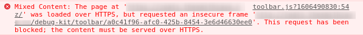

I run cakephp in docker containers behind a reverse proxy.  This means that there is common logging, Lets Encrypt certs when required etc.  However, CakePHP is normally run on port 80 in a docker container, so that means when you try and enable debug kit, the browser will complain about mixed content and NOT display the debugKit panel.



As can be seen, unless you look for it, you will go down the 'rabbit hole of pain', to try and find the issue.  To resolve, there are a couple of options

- Set up the docker container to run on HTTPS - NGINX can handle a self signed cert so wont cause a problem
- Force Cakephp to use a baseURL

#### Force CakePHP to use baseURL

This is the approach I took, as seemed easier, and since it should only be used in development, means locally its fine.

```
Edit config\app_local.php and add the following
```

```
/* 'App' => [
'fullBaseUrl' => 'https://url_to_site',
], */

```

This will tell CakePHP to use the BaseURL for any links that it generates, which as client is connecting to server with SSL, this all works out.
