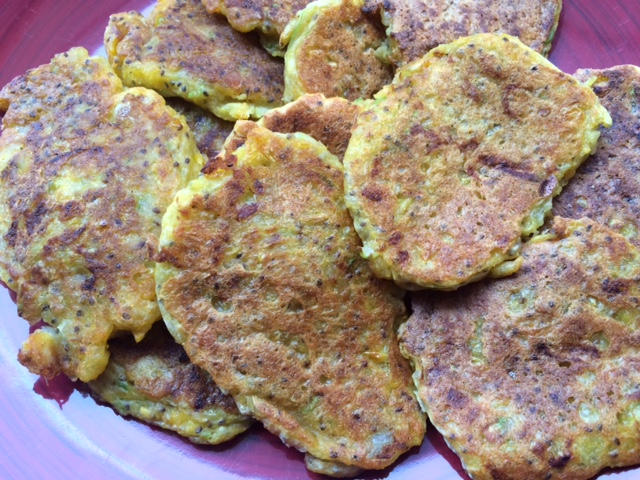

These fritters are delish - even through they have courgette in them!  I am not a fan of courgette but cannot taste them.  Eat with sweet-chilli sauce.

**Ingredients**

- 1 TBSP chia Seeds
- 3 TBSP water
- 1 Courgette (grated)
- 1 tin corn
- 1 onion (small)
- 1/4tsp salt
- Pepper
- 1c Rice Flour (Gluten Free)
- 1tsp Baking Soda

**Method**

Mix Chia seeds with water.  Set aside for 15 minutes to set.  Blend corn with a stick mixer to make creamed style corn.  Finely chop onion.  When egg replacer ready, mix all ingredients into a bowl.

Place dessertspoon size blobs into a frypan (use olive oil to prevent sticking).  Fritters will rise during cooking.  Flip over after a few minutes, or when appears to be half cook and continue to cook on the other side.  Place onto plate to cook when cooked.
