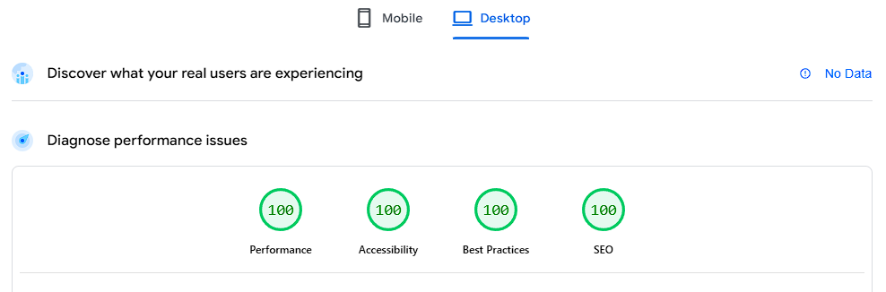
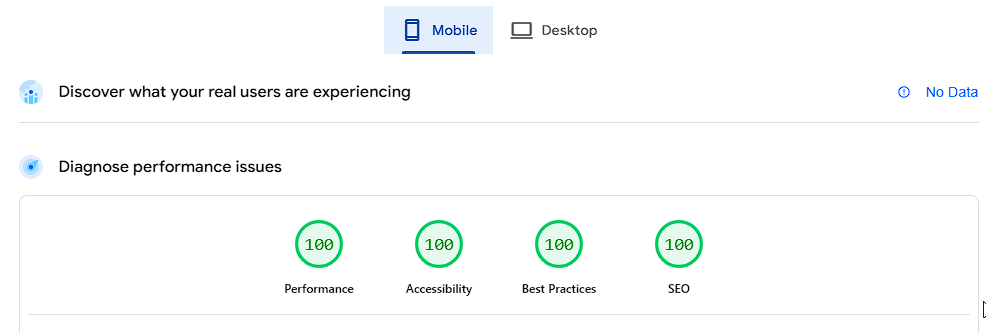

## Overview
I thought that I would write this, as it took me a bit to get up to speed with Eleventy, and its options.  This post will be updated from time-to-time depending on what else I want to add to the site.  So, many sites gave a good template, but it was bare bones, or hadn't been updated for awhile - probably the way this will go (LOL).

## Purple
Purple is the Eleventy template that I settled on.  The GitHub page is [here](https://github.com/ar363/eleventy-stylus-blog-theme).  This is dated 2023, so is based on Eleventy version 2.  Version 3 is out, so we will update to this version.

### Update package.json
This is the updated `package.json` file.  Run `npm install` to update the packages.

```json
{
  "name": "11ty-purple",
  "version": "1.0.0",
  "license": "MIT",
  "devDependencies": {
    "@11ty/eleventy": "^3.1.2",
    "@11ty/eleventy-img": "^6.0.4",
    "@11ty/eleventy-navigation": "^1.0.4",
    "@11ty/eleventy-plugin-rss": "^2.0.4",
    "concurrently": "^9.2.1",
    "luxon": "^3.7.2",
    "stylus": "^0.64.0"
  },
  "scripts": {
    "build:stylus": "stylus --compress ./stylus/ --out ./static/css/",
    "watch:stylus": "stylus --watch ./stylus/ --out ./static/css/",
    "build:11ty": "eleventy",
    "watch:11ty": "eleventy --serve",
    "build": "npm run build:stylus && npm run build:11ty",
    "dev": "concurrently -n stylus,11ty \"npm:watch:stylus\" \"npm:watch:11ty\""
  },
  "dependencies": {
    "@adobe/css-tools": "^4.4.4"
  }
}
```

### Update .eleventy.js
We update this file, as we add in the capability for images to be modified and the smallest image file required is requested by the browser.

```json
const { DateTime } = require('luxon')
const navigationPlugin = require('@11ty/eleventy-navigation')
const rssPlugin = require('@11ty/eleventy-plugin-rss')
const { eleventyImageTransformPlugin } = require('@11ty/eleventy-img');

module.exports = (config) => {
  config.addPlugin(navigationPlugin);
  config.addPlugin(rssPlugin);

  config.addPassthroughCopy('css');
  config.addPassthroughCopy('static');
  config.setDataDeepMerge(true);
  config.addPlugin(eleventyImageTransformPlugin, {
    // which file extensions to process
    extensions: 'html',
    // optional, output image formats
    formats: ['jpg', 'webp'],

    // optional, output image widths
    widths: [400, 800, 1200,"auto"],
    // optional, attributes assigned on  override these values.
    defaultAttributes: {
       loading: 'lazy',
       sizes:"(max-width: 600px) 100vw",
        decoding: 'async',
    },
  }),
  config.addFilter('htmlDateString', (dateObj) => {
    return DateTime.fromJSDate(dateObj, {zone: 'utc'}).toFormat('yyyy-LL-dd');
  });

  config.addFilter("readableDate", dateObj => {
    return DateTime.fromJSDate(dateObj, {zone: 'utc'}).toFormat("dd LLL, yyyy");
  });

  config.addCollection("tagList", collection => {
    const tagsObject = {}
    collection.getAll().forEach(item => {
      if (!item.data.tags) return;
      item.data.tags
        .filter(tag => !['post', 'all'].includes(tag))
        .forEach(tag => {
          if(typeof tagsObject[tag] === 'undefined') {
            tagsObject[tag] = 1
          } else {
            tagsObject[tag] += 1
          }
        });
    });

    const tagList = []
    Object.keys(tagsObject).forEach(tag => {
      tagList.push({ tagName: tag, tagCount: tagsObject[tag] })
    })
    return tagList.sort((a, b) => b.tagCount - a.tagCount)

  });

}
```
### Update Nunjuck NavBar to get 100% Accessibility
By default, you will only get 94% on the accessibility rating, due to an Aria setting within a `div`.  We need to change this to be a button instead.

1. Edit `_includes/components/navbar.njk`
2. Change the `<div` to be `<button` where the element `aria-label="toggle dark theme"` is contained within the tag
3. Change the `</div>`'s to be `</button>` 

There should be two places this is changed.

### Update CSS Styles

#### Img tab

Edit `stylus/base/image.styl` to be as follows:
```css
img {
  width 100%
  height auto
  max-width: 100%
}
```

### typography file

Add the following to `stylus/base/image.styl` :
```css
pre{
      overflow-wrap: break-word;
      word-wrap: break-word; /* For older browser compatibility */
      text-wrap-mode: wrap;
}

table {
  max-width: 100vw;  /* sets maximum width to 100% of viewport width */
  width: 100%;  /* Ensure tables take up 100% width */
  box-sizing: border-box; /* Includes padding and border in the elements total size */

}

li {
  text-wrap: balance; /* Example: balance the lines within list items */
}
```

Hopefully when you now do a `npm run build` or a `npm run dev` you should get some output that mimics my website.

## Scoreboard
### Desktop Lighthouse Score




### Mobile Lighthouse Score


