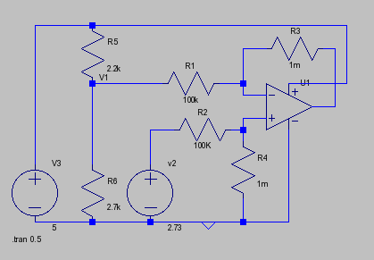
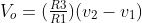

Recently on a project, I was using a DS18B20 one wire temperature sensor, but it appears to be reading the temperature incorrectly.  After checking the code and online, I gave up and put a LM335 precision temperature sensor next to the DS18b20 to compare temperature readings.  As a control, I used a $5 thermometer also situated next to the two sensors.  I even coupled the DS18B20 and LM335 together using blue-tack to ensure that they were reading the same piece of air.  It turned out that over a range of temperature, the LM335 followed the thermometer most accurately.  I Found that the DS18B20 would either be under, or over the thermometer temperature, and sometimes by a degree or two.

So, I decided that I would make a daughter board to replace the DS18B20 from the circuit.  However, the LM335, while can be directly interfaced to the A/D converter means that I can only read 0.5'C changes on the device, although it can do 0.1.  This is because the LM335 reads at 10mV 'C and works relative to absolute zero (-273 'C).  Therefore, 0'C is output at 2.73v.  The range that I was interested in was 0-40'C.  This meant a voltage change of 3.13 - 2.73= 400mV.  I was already using the A/D converter with a reference of 5V for humidity, so the built in A/D converter of the ATMega AVR chip was capable of measuring in (5/1024) 4.8mV steps.  This meant that there were only 83 steps that represent the whole range.  So, how to increase the number of steps?

I decided that I wanted to have a 0-40'C range.  So, we need to shift the level such that around 0'C (2.73v) is seen as zero.  Then we want to amplify anything above this by 10, such that each tenth of a degree is 10mV, and each degree is 0.1V.  To do this, we need to use a differencing amplifier with a gain of 10.  The following circuit was created in LTSpice to test the parameters before actual construction.

From the diagram, V2 represents that input from the LM335.  V3 is the power supply for the circuit.  When modifying the circuit, note the following:

R3=R4 and R1 = R2 Gain (Amplification) is determined by R3 and R1.

The formula for the output voltage, given the above is .  V1 is the junction between R5 and R6.  This is effectively the voltage  v2 will be at which the output of the op-amp start going above zero.  If V2 goes above this value, then the output will increase from 0.  Because I am using a single supply op-amp, if V2 is below V1, then the op-amp will stay a 0v.

So, since I wanted to give a gain of 10, R3 must be 10 times larger than R1.  R3 and R1 are significantly larger than R5 and R6 as these resistors do actually affect gain, but since they are relatively small, it will not affect too much and has been omitted.

V1 is derived by the following formula (and substituting for our scenario)

2.76v = 2.76/0.01=276'K.

Latex equation: `[v_1 = \frac{V_{Supply} * R_6}{R_5+R_6} = \frac{5*2700}{2700+2200} = \frac{13500}{4900} = 2.76v`

276 - 273 = 3'C which is fine as if the room gets that cold, then the central heating is not working!

So, what is the resolution of the A/D converter now?  Since we multiplied the output of the LM335 by 10, so 1'C now equals 0.1 volt, we have (5v/0.1) = 50'C range (it is actually less than that because an op-amp cannot swing to either rail fully, which is why you must ensure that the temperature range that you want to measure can be output by the op-amp).  As we have increased the gain of the amplifier by 10, 4.8mV now represents 0.05'C instead of 0.5'C which is the range I was wanting.  I could have set the gain to 5 and then each step of the A/D would represent 0.1'C.

The LM335 does have an adjustment leg for calibrating the sensor, however, I have decided to do the calibration in software.  You could put a potentiometer on the adjustment leg and have a manual adjustment (as well as software if desired) if that is required.  I didn't bother as the range that the circuit covers is wider that I really do need (10-25'C)

Related information
