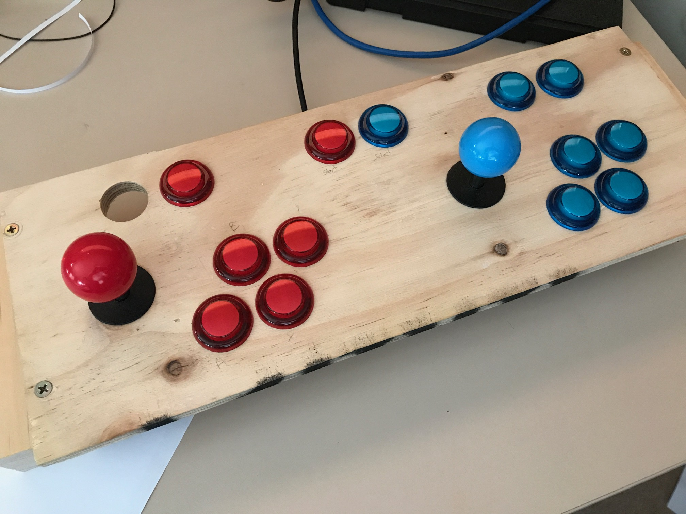

So, been inspired recently reminiscing about the old video games of yester-year.  There is now a distribution called Retropie, so I fired up a spare Pi, loaded the card and this is impressive.  Everything you want already there.  Great.

Next step was to replace the keyboard with a control panel like an arcade machine.  So, there goes many hours of looking at what other people have done, images on Google etc.  I don't have a lot of space around the house, so instead of a full size arcade cabinet, I have instead decided on a table top cabinet.  That way it can be moved easily around the place.

So, one place I Googled, I bought his plans for the table top unit, and assembled the control panel it to see if I like it, as I didn't really know what I wanted.  Soon it became apparent that I didn't know what I wanted to/should use all the buttons for.

_The above picture shows the test control panel used to see if the panel is easy to use. Note the missing button - that was because the joystick mechanics slightly covered up the hole so I couldn't put a button in it without modifying it._

I decided a number of changes of this after playing with it:

- Six buttons are better than 4 per player as this allow for street fighting games (not that I play them)
- Need to have a pause button
- Want to configure for a screenshot
- Having three groups of two buttons didn't seem logical to me

I drew up the replacement panel in QCad, and the width of the control panel has now grown from 445mm to 525mm wide, and their are now only four button along the top of the panel (1 player, Pause, Coin and 2 player).  1 player - Coin combo quits the emulator, and will look to make 1 player - Pause combo to take a screen shot.  Also, as Retropie has many different emulator engines, I would like to include a keyboard drawer as well - for example Apple _II_e games require a keyboard even if the game can be played with a joystick!

**Modifications to the code**

In the new panel, I mounted the joysticks turned 90' so that there would be room for a LCD display should I get around to putting one in it.  This meant that I needed to redefine my joystick in Emulation Station.  Once I did this, all was well except for the text based menus, where Left/Right became Up/Down and Up/Down became Left/Right.  To fix this, I did two modifications to the code

Edit **_/opt/retropie/supplementary/runcommand/runcommand.sh_**, search for joy2key and then change to this line

`“$ROOTDIR/supplementary/runcommand/joy2key.py” “$JOY2KEY_DEV” kcub1 kcuf1 kcuu1 kcud1 0x0a 0x09 &`

to be this:
`“$ROOTDIR/supplementary/runcommand/joy2key.py” “$JOY2KEY_DEV” kcud1 kcuu1 kcub1 kcuf1 0x0a 0x09 &`

Also, edit _/home/pi/RetroPie-Setup/scriptmodules/helpers.sh_, search for joy2key and change this line:

`params=(kcub1 kcuf1 kcuu1 kcud1 0x0a 0x20)`
to
`params=(kcud1 kcuu1 kcub1 kcuf1 0x0a 0x20)`

This is probably the incorrect way to do this(!) and will break on updates.  One day I might get around to looking at the actual code to understand and then feed back, in case it is looking at some config file.

More to come...
