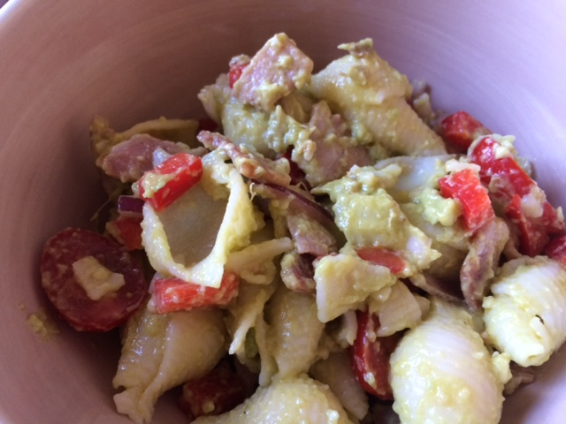

INGREDIENTS

- 2C Pasta Shells
- 1/4 - 1/2 Red Onion (Sliced)
- 1/2 Red or Yellow Capcicum
- 6-8 Small tomatoes (halved)
- Smoked Chicken
- 1-2 TBSP Oil

Dressing

- Avocado
- 1/4tsp Salt
- 1 TBSP lemon juice
- 1-2 cloves crushed garlic

METHOD

Boil pasta until Al Dente (10 - 15 minutes as per packet directions)

Prepare other ingredients.  Chop up/rip up chicken.  Drain pasta in colander and run quickly under cold water.  Shake.

Mix all ingredients for dressing (Guacamole).

Place pasta in bowl and add 1-2 TBSP old to stop it sticking together.  Add chopped vegetables along with the Chicken.  Mix together.  Add dressing when ready to serve and mix thoroughly.

ALTERNATIVES

Use 3-4 rashers of bacon instead of Chicken
