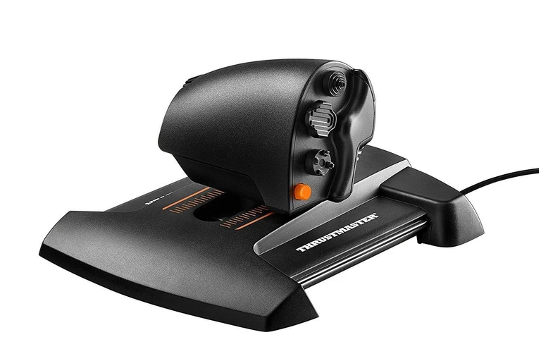

## Overview

The Thrustmaster TWCS throttle is fine...until it isn't.  Lots of people have been mentioning on forums about the z-axis get jittery after a while using the control.  Most forums talk about carefully splitting the pot apart to resolve.  However, this are only ever a temporary measure.

I purchased a similar 10k pot online from Mouser.  Mouser P/N: 667-EVW-AE4001B14,  Manufacturer part number: EVW-AE4001B14 (Panasonic).  These were recommended.  Overall the pot works as expected.  The downside is that the pot is a 347 degree turn, vs the thrustmaster of what seems around 180 degrees.  What this means is that you must calibrate the control after you replace the component, otherwise control range will be from slightly below to slightly above the centre position.

## Replacement Procedure
The replacement was quick and easy.  No pictures unfortunately, but here are the basic steps:

1. Remove all the black screws from underneath the control.
2. Carefully remove the bottom plate - this will expose the control board.
3. From here you can see a black arm go from the throttle slider to the potentiometer on the control panel.  I just removed the arm off the pot without removing the screw from the slider.
4. Now comes the slightly tricky bit - removing the pot - this is how I did it....
	1. Use a small screwdriver (jewellers) and start at the end with only one tab on it.  
	2. Hold the screwdriver near the end with the single tab, and heat the tab up with soldering iron.  
	3. When the solder is melted, twist the screwdriver to lift that end of the pot off the circuit board.
	4. Now change to the other end - heat the pins and slowly lift the pot off the board.
5. When the pot is removed, tin the pads (use the solder iron to melt the solder nicely onto the pads).
6. Tin the pins on the new pot (on the side that will be against the circuit board).
7. Remove the two location tabs that are not required on the new pot.
8. Position pot in the correct place.
9. Heat the pins to solder the new pot into place.
10. Put the arm back into place on the pot (you probably need to change the pot to be in the correct location)
11. Put the bottom on, and insert the screws.

## Testing and Calibration
Now that the pot is replaced, and it has been re-assembled, now for the testing.

> [!WARNING]
> This procedure requires that the Thurstmaster drivers are not installed.  If they are installed, you do not get the calibrate option which is needed with this pot.

1. Plug the device into the computer (Windows in this case)
2. Go **Start** > **Run**.
3. Type in **joy.cpl** and press **enter**.
4. Select the **TWCS Throttle** in the list.
5. Select **Properties**
6. Select **Settings**
7. Select **Calibrate**.

Go through the settings.  Be aware that it will show that the throttle will not go end to end when in the calibration screen.  When finished, the z-axis will go from low to high with the full movement of the stick.

