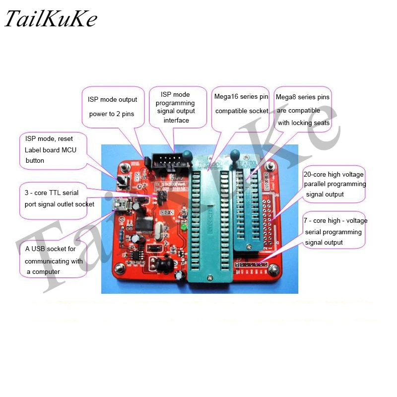

Purchased the below pictured AVR programmer from Aliexpress.  Needed to use AVR Studio to get it going until I found the magic sauce.



Well, the magic sauce is this for linux, use the device type of stk500pp (parallel programming).  Once this is done, works a treat.  However, inside of Eclipse, cannot seem to read fuse values, or device type.  Maybe there is a plug in update, but at least it allows to program devices.

For a command line option, this is what works

```
avrdude -p m88p -c stk500pp -P /dev/ttyUSB0 -b 115200 -U signature:r:file.bin
```

